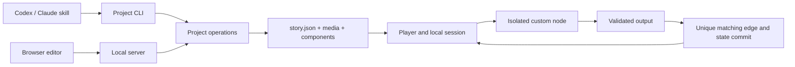

# Architecture

The installable skill is self-contained in `rusie-film/`. Repository scripts and test fixtures are development resources; the runtime package contains no demonstration project or test media.

| Module | Responsibility |
| --- | --- |
| `assets/shared/story.js` | Story validation, branching, local sessions and replay |
| `assets/shared/custom.js` | Component contracts, selected input and typed output |
| `assets/shared/catalog.js` | Asset definitions, references and presentation validation |
| `assets/shared/control-node.js` | Fixed BaseNode bridge/lifecycle and inheritable ControlNode view methods |
| `scripts/project.mjs` | Contained file access, revision-safe writes, imports and export |
| `scripts/server.mjs` | Token-protected local editor HTTP interface |
| `assets/editor.js` | Story graph, inspector and editor coordination |
| `assets/asset-editor.js` | Eight-category asset library and asset drafts |
| `assets/custom-editor.js` | Graph/role definitions and custom-node configuration |
| `assets/player.js` | Media lifecycle, session advancement and player controls |
| `assets/scene-player.js` | Explicit background, portrait and dialogue presentation |
| `assets/node-host.js` | Sandboxed frame lifecycle and controlled result bridge |
| `assets/serve.mjs` | Shared static transport and exported-work launcher |

## Data flow

The graph and role definitions hold key story data. Custom nodes receive only declared fields. A node's `complete(output)` can complete its current visit once; its own edges match `lastNode.output`. Result validation and the selected edge commit before the player moves to the next node. Stored progress is reconstructed from validated session history.

Asset catalog associations record creative references. A scene's `presentation` explicitly selects its background, portrait and dialogue. Items and audio are controlled by story or component logic; catalog membership does not automatically play or grant them.

The public extension type is ControlNode. BaseNode encapsulates immutable base inputs and completion; inherited views may replace choices, inputs, styling, history and inventory inside the component document. Local runtime events are handled by the derived class. The storage field `custom` remains compatible; it is not a second public extension type. History projection is opt-in and includes only the latest 50 transition summaries, without past outputs.

## Canvas and control lifecycle

The graph is the control layer: enter → apply entry presentation → pre-video → dialogue → controls/choices → validate and commit → dispose controls → next node. The persistent canvas separately owns background, video, portrait and dialogue layers. Control disposal does not dispose the canvas.

`assets/canvas-player.js` owns layer renderers, media buffers and tail retention. `scene-player.js` applies graph entry directives; `player.js` coordinates the graph lifecycle. `shared/canvas-protocol.js` validates component canvas commands. Isolated controls may update visual layers through their current-visit bridge without modifying graph definitions.

An ended clip remains visible during choices and across subsequent nodes without explicit background changes. A new clip is invisible until its first presented frame, then replaces the retained clip atomically. Explicitly setting a background cuts the old tail on node entry, including when that node also has a pre-video. Its own new tail remains after that video ends. Graph restart/disposal clears canvas state; portrait and dialogue are transient by default. See the [AI lifecycle contract](../rusie-film/references/canvas-lifecycle.md).

The editor and CLI write the same project using a revision check and an exclusive write lock. Imports validate their type and paths; exports create a new directory. Custom Web packages provide their own runtime and resource files and execute in an opaque-origin sandbox with a MessageChannel bridge. The sandbox does not provide hard CPU or memory quotas.
